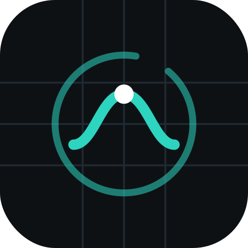

<p align="center"></p>

# ZenPEQ

Lightweight system-wide parametric EQ for Android (API 28+) built on `DynamicsProcessing`.

- Up to 10 parametric filters (PK / low shelf / high shelf), live-edited
- Auto-Preamp, AutoEQ / squig.link text import, JSON profiles in DataStore
- Wired 3.5 mm headset detection: plug → IEM profile on, unplug → bypass
- Two Quick Settings tiles: EQ on/off, cycle profile

## Build
```
gradle wrapper --gradle-version 8.9   # once, to generate ./gradlew
./gradlew assembleDebug
```
CI (`.github/workflows/build.yml`) uses `gradle/actions/setup-gradle`, so no wrapper is required there.
Releases and signing: see **Releases & updates** below.

## Notes
- The engine attaches to audio session 0. Google deprecated global effects, and some OEM builds ignore or reject them; the app shows the error when that happens.
- DynamicsProcessing EQ bands have only a cutoff and a gain (no Q). ZenPEQ computes the exact RBJ biquad response of your filters and renders it onto 48 log-spaced bands (falls back to 24 / 10 if a device refuses).

## v1.1
- Export/share any profile as JSON or Equalizer APO `.txt` (shelves exported as `LSC`/`HSC`; `LSQ`/`HSQ` are accepted on import). Import `.json` or `.txt`.
- Audio session mode: Auto (global, falling back to per-app), Global, Per-app. Per-app attaches to sessions announced via `ACTION_OPEN_AUDIO_EFFECT_CONTROL_SESSION`; players that never broadcast it can't be equalized in that mode.
- Boot restart + battery-optimization hint. Note: targeting API 35+ forbids starting a `mediaPlayback` foreground service from `BOOT_COMPLETED`.
- Drag band points on the graph; ±0.1 dB steppers; profile search.

## v1.2
- Up to 16 PEQ bands (peak / low-shelf / high-shelf), gain ±15 dB, Q 0.4–12; numeric entry for freq/gain/Q/preamp (`4.5k` works), ±0.1 steppers.
- Biquad response (+ optional `GraphicEQ:` layer) rendered onto a 64-band PreEq (falls back to 32/16), plus a brickwall limiter (0 dBFS, 1 ms attack) after the EQ.
- APO/AutoEq import/export incl. single-line `GraphicEQ:`; export can use LSC/HSC or LSQ/HSQ shelf tokens.
- Per-output profiles: 3.5 mm, USB DAC, Bluetooth (by name) remember their last profile. Notification has an A/B bypass action.

## Releases & updates
No setup needed. CI (`.github/workflows/build.yml`) builds on every push; on pushes to `main`/`master` (or `v*` tags) it signs a release APK and publishes a GitHub Release with `ZenPEQ-<version>.apk`.

- **Keystore:** created automatically on the first release run and kept on a `signing` branch. Every later run reuses it, so each APK installs as an update over the previous one.
- **Versions:** `versionCode` = workflow run number, `versionName` = `VERSION_BASE.<run number>` (edit `VERSION_BASE` in the workflow) or the tag name for `v*` tags.
- **Optional hardening:** if you add a repository secret `KEYSTORE_PASSPHRASE` *before the first run*, the keystore is stored encrypted with it. Without the secret the key's password is stored next to it, so on a public repo anyone could read the key.
- **Never delete the `signing` branch** (or change the passphrase): a new key means everyone must uninstall before installing again.

## v1.3 UI
- Main screen: profile bar (⋮ menu for Save as / Import / Export / IEM / Delete), **Simple | Pro** switch, EQ On/Off pill, Settings sheet (gear).
- Simple: Bass / Warmth / Vocals / Treble sliders + presets (Flat, Bass Boost, Vocal Clarity, Sibilance Tamer). Pro: draggable graph, band chips, editor for the selected band.
- Engine options (auto-preamp, limiter, output switching, audio session, background) live in Settings. DSP engine unchanged.
